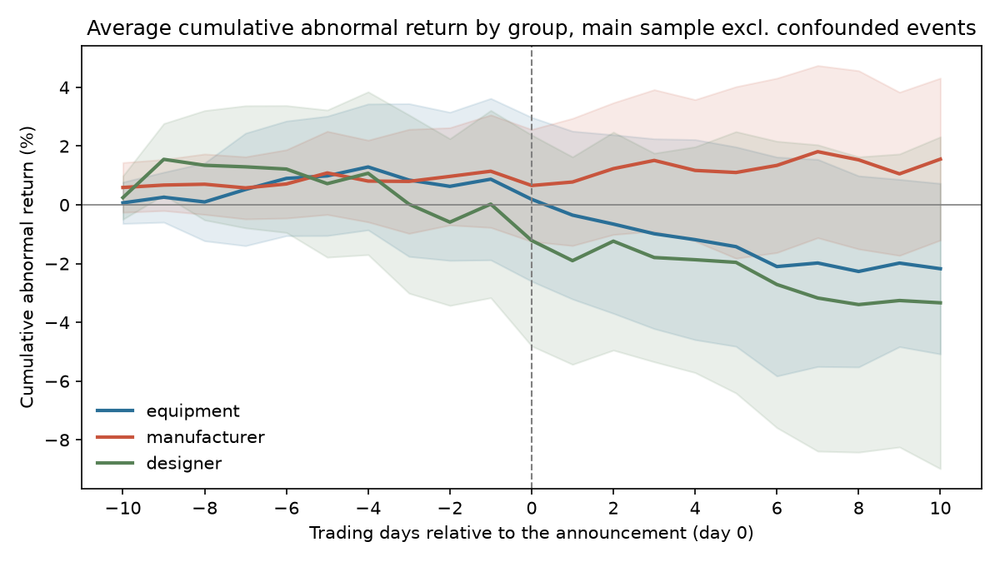

# Chips under control: how semiconductor stocks react to export controls

**Event study of 23 export-control announcements by the US, the Netherlands, Japan and China (2019-2026) and the stock-market reaction of 11 semiconductor companies across the supply chain.**

**[Open the interactive dashboard](https://nicopiazzi.github.io/semis-export-controls/)**

Since 2019 export controls have become the main weapon of the chip race: the US blacklisted Huawei and SMIC and restricted AI chips and chip-making tools, the Netherlands and Japan followed with controls on lithography and other equipment, and China answered with controls on gallium, germanium and rare earths. This project asks a simple question: **when a new control is announced, does the market punish the whole semiconductor sector, or only the part of the supply chain the rule targets?**

## Key findings

| | Result (announcement day + next) | p-value |
|---|---|---|
| **1. The market reads the rules.** The segment a rule targets falls more than the other two | -2.2% vs -0.7% (difference -1.5 pp) | 0.04 |
| **2. Chip designers are the most exposed.** Nvidia and AMD after a new restriction | -1.9% | 0.03 |
| **3. Chip manufacturers barely react.** TSMC, Samsung, SK Hynix, SMIC | -0.4% | 0.19 |

The targeting result holds in all seven robustness checks and widens over the following week (-3.2 pp over six trading days, p = 0.01). Results exclude two announcements that coincided with major tariff news (see [Limitations](#limitations)).



## Data

**Announcements** ([`data/events.csv`](data/events.csv)): 23 announcements, each with its date, time and time zone, issuing body, primary and secondary source, the supply-chain segment most exposed, and notes on unrelated news in the same days.

| Sample | Announcements | Use |
|---|---|---|
| Main | 16 new restrictions | Main tests |
| Robustness | 3 restrictions that were expected or overlap another event | Checks |
| Loosening | 4 restrictions lifted or suspended | Analysed separately |

**Stocks**, by role in the supply chain, each on its home exchange and benchmarked against its home market index:

| Equipment makers | Chip manufacturers | Chip designers |
|---|---|---|
| ASML (Amsterdam), Applied Materials, Lam Research, KLA, Tokyo Electron | TSMC (Taipei), Samsung, SK Hynix (Seoul), SMIC (Hong Kong) | Nvidia, AMD |

**Prices**: daily adjusted closes from Yahoo Finance, January 2018 to November 2026. Raw prices are not stored in the repository; `scripts/download_prices.py` downloads them.

## Method

1. **Market model.** For every stock and announcement, alpha and beta are estimated by OLS on 250 trading days ending 11 days before the announcement, excluding the days around all other announcements:
   `R_stock = alpha + beta × R_market + e`
2. **Abnormal return** = actual return − predicted return. **CAR** = sum of abnormal returns over a window; the main window is [0,+1], the announcement day and the next.
3. **Day 0 by exchange.** Each announcement is timed in its own time zone, and day 0 is the first session of each stock's exchange that closes after the news. A US rule released after the New York close therefore has day 0 on the next day in New York and in Asia.
4. **Tests.** All stocks react on the same day to the same news, so their abnormal returns are correlated. Stocks are first averaged within each group for each announcement, and the group averages are then tested across announcements (t-test and Wilcoxon signed-rank). The stock-level test of Boehmer, Musumeci and Poulsen (1991) is also reported in `results/group_tests.csv`.
5. **Targeting test.** For each announcement aimed at one segment, the CAR of the targeted group minus the average CAR of the other two groups, tested across announcements.

### Robustness

| Specification | Targeted minus others | p |
|---|---|---|
| Base: market model, 250 days, CAR[0,+1] | -1.54% | 0.04 |
| Market-adjusted returns (beta = 1) | -1.83% | 0.02 |
| Shorter estimation window (120 days) | -1.42% | 0.05 |
| ASML and TSMC via New York listings | -1.34% | 0.05 |
| Without SMIC | -1.39% | 0.05 |
| Window CAR[-1,+1] | -2.14% | 0.02 |
| Window CAR[0,+5] | -3.17% | 0.01 |

Full table, including the other headline results: `results/robustness.csv`.

![CAR[0,+1] by announcement and company](results/fig_heatmap_car01.png)

## Limitations

- **Few events.** 14-16 announcements per test: one unusual event can move an average, and several tests were run.
- **Confounding news.** Two Chinese announcements fell on days of major US-China tariff news (4 April and 9-10 October 2025) and are excluded from the "clean" sample. On 4 April 2025 the S&P 500 fell about 6%: with betas around 1.7, the market model predicted very large falls and produced large *positive* abnormal returns. This is a known weakness of the model on crash days; the market-adjusted check addresses it.
- **Announcement times.** The exact hour is verified for five announcements and assumed (midday, issuer's time zone) for the others; the two-day window makes the results robust to this.
- **Overlapping windows.** For Asian stocks, a few announcement pairs share the same day 0 (for example the Dutch decree of 30 June 2023 and the Chinese gallium controls of 3 July 2023); one of each pair is kept only in the robustness sample.
- **Associations, not causality.** The study measures price moves around announcement dates.

## Reproduce

Requires Python 3.10+.

```bash
pip install -r requirements.txt
python scripts/download_prices.py     # prices from Yahoo Finance -> data/raw/
python scripts/event_study.py         # analysis -> results/
python scripts/build_dashboard.py     # dashboard data -> docs/data.js
```

All methodological settings (estimation window, event windows, excluded events) are at the top of `scripts/event_study.py`.

## Repository structure

```
data/events.csv              announcements, sources and timing notes
scripts/download_prices.py   downloads daily prices (Yahoo Finance)
scripts/event_study.py       market model, abnormal returns, tests, figures, robustness
scripts/build_dashboard.py   exports results for the dashboard
results/                     tables (CSV) and figures (PNG)
docs/                        interactive dashboard, published with GitHub Pages
```

## Author

Nico Piazzi · BSc Management & Marketing, University of Bologna. This project extends my thesis on ASML and barriers to entry in the lithography market.
